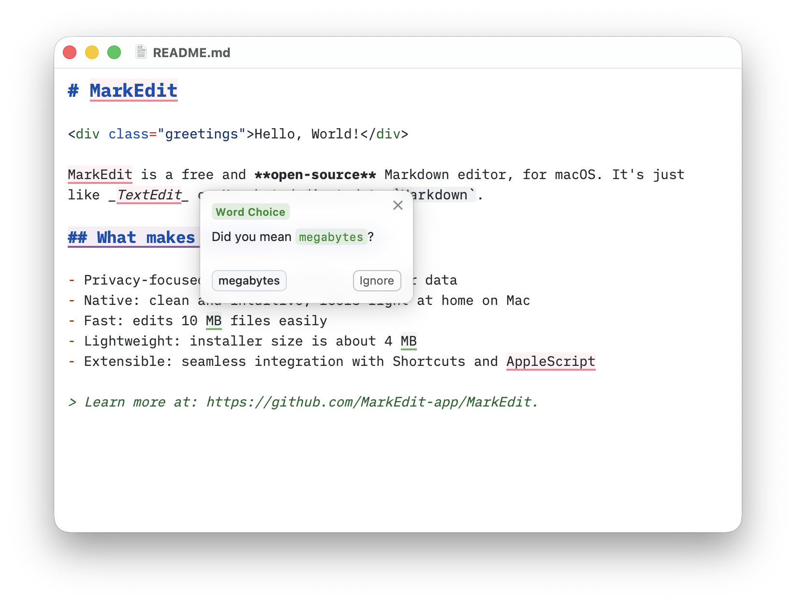

# MarkEdit-proofreading

[MarkEdit](https://github.com/MarkEdit-app/MarkEdit) grammar checker based on [Harper](https://writewithharper.com/).




## Installation

Install this extension from the [MarkEdit Extension Registry](https://markedit-app.github.io/extensions/#markedit-proofreading).

## Configuration

This extension provides three presets to control how aggressively Harper checks your writing. Each preset disables specific [rules](https://writewithharper.com/docs/rules) via [`setLintConfig`](https://writewithharper.com/docs/harperjs/configurerules) and filters by lint kind as a safety net:

- `"strict"` (default): All Harper rules are active
- `"standard"`: Disables Enhancement, Style, and WordChoice rules
- `"relaxed"`: Also disables Readability, Redundancy, and Repetition rules

You can customize behavior from `settings.json` with the `extension.markeditProofreading` section (see [MarkEdit advanced settings](https://github.com/MarkEdit-app/MarkEdit/wiki/Customization#advanced-settings)):

```json
{
  "extension.markeditProofreading": {
    "autoLintDelay": 1000,
    "addToDict": true,
    "lintPreset": "relaxed",
    "lintRuleOverrides": {
      "SpelledNumbers": false,
      "NoOxfordComma": true
    },
    "disabledLintKinds": ["Regionalism"],
    "dialect": "Australian",
    "dialectFallbacks": ["American"]
  }
}
```

- `autoLintDelay`: Delay in milliseconds before automatic proofreading runs after a document change (default: `1000`). Set to `-1` to disable automatic proofreading entirely (use "Proofread Now" to lint on demand).
- `addToDict`: When `true` (default), clicking "Ignore" on a flagged word also adds it to a personal dictionary so it won't be flagged in future sessions. Set to `false` to disable this behavior.
- `lintPreset`: `"strict"` (default), `"standard"`, or `"relaxed"`.
- `lintRuleOverrides`: Per-rule overrides (`true` / `false` / `null`) applied on top of the preset.
- `dialect`: The English dialect Harper checks against (default: `"American"`). One of `"American"`, `"British"`, `"Australian"`, `"Canadian"`, or `"Indian"`. Determines which spellings are flagged and which spellings suggestions prefer.
- `dialectFallbacks`: Additional dialects whose spellings are also accepted (default: `[]`). A word flagged as a misspelling by `dialect` is kept only if every fallback dialect also flags it; if any fallback accepts the word, it is not flagged. For example, `"dialect": "Australian"` with `"dialectFallbacks": ["American"]` suggests Australian spellings but does not flag American ones. Invalid names, duplicates, and the primary dialect are ignored. Suggestions always come from the primary `dialect`.
- `disabledLintKinds`: Additional lint kinds to filter out. Available kinds:
  - `Agreement`, `BoundaryError`, `Capitalization`, `Eggcorn`, `Enhancement`
  - `Formatting`, `Grammar`, `Malapropism`, `Miscellaneous`, `Nonstandard`
  - `Punctuation`, `Readability`, `Redundancy`, `Regionalism`, `Repetition`
  - `Spelling`, `Style`, `Typo`, `Usage`, `WordChoice`

For a full list of available rule names, see:
https://writewithharper.com/docs/rules

## Dictionary

When `addToDict` is enabled (default), clicking "Ignore" on a flagged word also adds it to a personal dictionary stored at `~/Library/Containers/app.cyan.markedit/Data/Documents/proofreading-dict.txt`. Dictionary words are automatically loaded when the extension starts.

## Development

Install dependencies:

```sh
yarn install
```

Lint the codebase with [ESLint](https://eslint.org/):

```sh
yarn lint
```

Run the test suite with [Vitest](https://vitest.dev/):

```sh
yarn test
```

Build the extension (runs lint, tests, then [Vite](https://vite.dev/)):

```sh
yarn build
```

## Contribution

Bug fix pull requests are generally welcome. For feature additions or behavior changes, please open a discussion or issue first so the approach can be agreed upon before any work begins.
